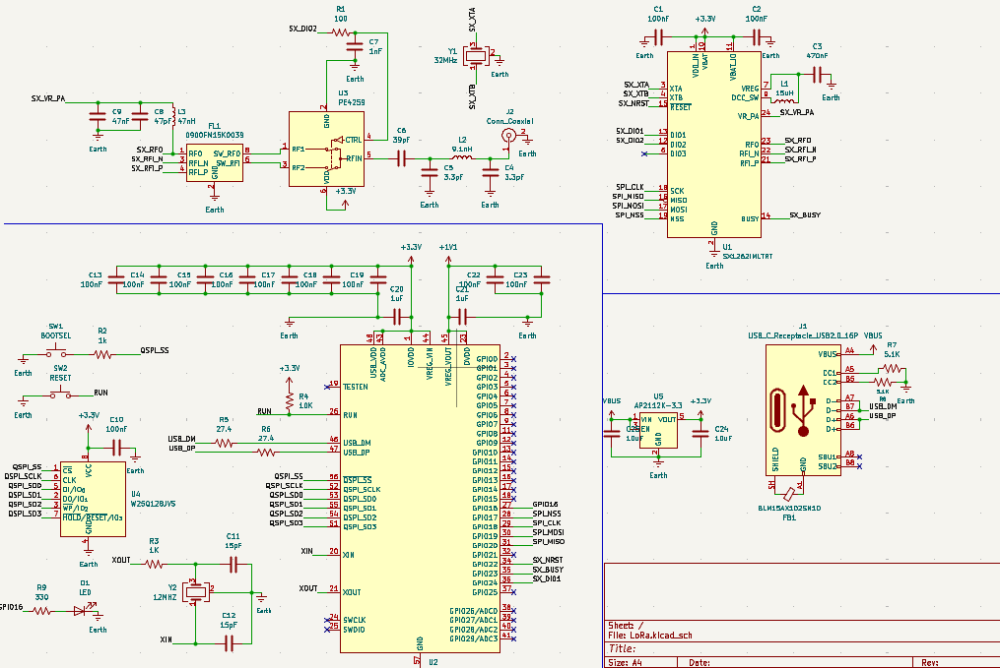
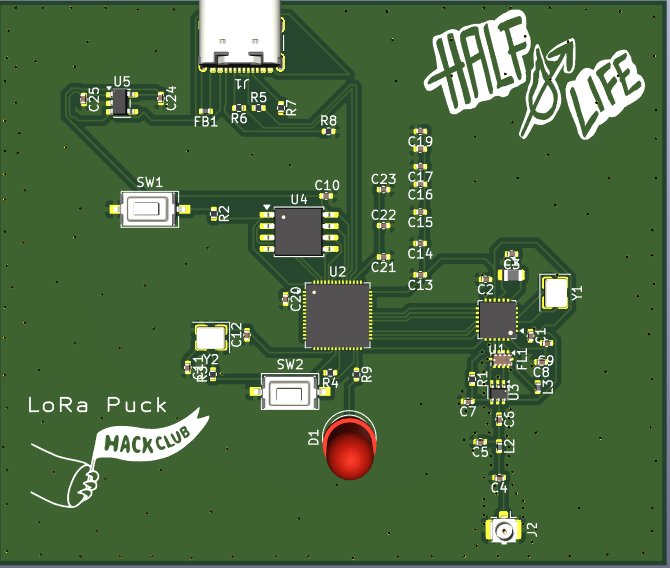

# LoRa_Puck
Building a LoRa project, based on the [HackClub LoRa Starter Project](https://blueprint.hackclub.com/starter-projects/lora#applying-these-concepts). I am using the [SX1262 by Semtech](https://www.semtech.com/products/wireless-rf/lora-connect/sx1262) for its radio module and [Microcontroller RP2040](https://pip-assets.raspberrypi.com/categories/814-rp2040/documents/RP-008371-DS-1-rp2040-datasheet.pdf). It's designed to send text from the Serial monitor over LoRa and a somewhat replica of it(one running the receiver firmware) can pick it up from a distance.

# How it works
The idea is pretty straightforward. I type a message into the Arduino Serial Monitor, and the RP2040 reads it. The RP2040 then sends the message as bytes to the SX1262 through SPI. The SX1262 takes those bytes, prepares them for LoRa transmission, and sends the signal through the antenna.

So, the RP2040 handles the instructions and the message, while the SX1262 handles the actual radio communication. The second LoRa device with matching radio settings would receive the message and turn the bytes back into readable text.

I plan to improve on this project and eventually create a mini RFID gate system, where an RFID card will act as the transmitter and send a signal to a LoRa receiver. The receiver will then determine whether access should be granted and instruct the gate to open or remain closed.

# Components
| Component | What it does |
|---|---|
| **RP2040** | The main microcontroller. It reads the message and communicates with the SX1262. |
| **SX1262** | The LoRa transceiver. It handles sending and receiving radio signals. |
| **W25Q128JV** | External flash memory used to store the RP2040's program. |
| **PE4259** | RF switch that connects the antenna to the transmit or receive path. |
| **FL1 (0900FM15K0039)** | Balun that connects the SX1262's differential RF pins to the single-ended RF path. |
| **Antenna** | Sends and receives the radio-frequency signal. |
| **USB-C** | Provides the USB connection for programming and serial communication. |
| **LED + 330 Ω resistor** | The LED is used as a transmission indicator, and the resistor limits the current flowing through it. |

# Firmware
I wrote the [firmware](lora_arduino.ino) using Arduino IDE, [RadioLib Library](https://github.com/jgromes/RadioLib/tree/master) for the SX1262 and [SPI library](https://github.com/arduino/ArduinoCore-avr/blob/master/libraries/SPI/src/SPI.h) to configure SPI communication.

You can find the full Bill of Materials [here](LoRa_BOM.xlsx).

